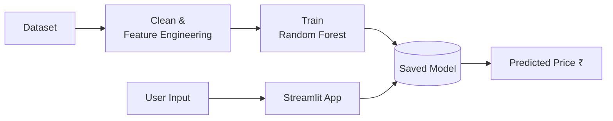

# Flight Price Prediction

A machine learning web app that estimates Indian domestic flight ticket prices. It uses a **Random Forest Regressor** trained on historical flight data and a **Streamlit** interface for interactive predictions.

## Features

- Predicts ticket price (in ₹) from airline, route, date, timings, duration and number of stops
- Random Forest model (600 trees, max depth 25) with an R² of about 0.81
- Feature engineering pipeline for dates, times and durations

## Tech Stack

- Python
- pandas, NumPy
- scikit-learn
- openpyxl (to read the `.xlsx` dataset)

## Project Structure

```
Flight_Price_Prediction/
├── Flight_Price_Predict.py                  # Pipeline, model training, prediction and Streamlit UI
├── datasets_140442_330428_Data_Train.xlsx   # Training dataset
├── requirements.txt                         # Python dependencies
└── README.md
```

## How It Works

1. **Cleaning:** rows with missing values are dropped.
2. **Feature engineering:**
   - `Date_of_Journey` is split into journey day and month
   - `Dep_Time` and `Arrival_Time` are split into hour and minute
   - `Duration` (e.g. `2h 50m`) is split into hours and minutes
   - `Total_Stops` is converted to a number (`non-stop` becomes `0`)
   - `Route` and `Additional_Info` are dropped
3. **Encoding:** `Source`, `Destination` and `Airline` are one-hot encoded. "New Delhi" is merged into "Delhi".
4. **Model:** a `RandomForestRegressor` is trained and saved as `finalized_model.pkl`.
5. **Evaluation:** the script reports MAE, MSE, RMSE, R² and adjusted R².

## Workflow


## Installation

```bash
git clone https://github.com/vaishnaviwangalwar-cpu/Flight_Price_Prediction.git
cd Flight_Price_Prediction
pip install -r requirements.txt
```

## Usage

### 1. Train the model (first run only)

The trained model file (`finalized_model.pkl`) is not included in the repo, so generate it first:

1. Open `Flight_Price_Predict.py`.
2. At the bottom, uncomment the line `# training()`.
3. Run:
   ```bash
   python Flight_Price_Predict.py
   ```
4. When you see `Model created successfully...`, re-comment `training()` so it doesn't retrain on every launch.

### 2. Launch the app

```bash
streamlit run Flight_Price_Predict.py
```

Then open the URL shown in the terminal (usually http://localhost:8501).

### 3. Get a prediction

Choose the airline, source, destination, journey date, departure and arrival times, duration and number of stops, then click **Predict Flight Price**.

## Model Performance

| Metric | Value |
|--------|-------|
| R² Score | ~0.81 |

Exact MAE, MSE and RMSE values are printed when the model is evaluated.

## Supported Inputs

- **Airlines:** IndiGo, Air India, Jet Airways, SpiceJet, Multiple carriers, GoAir, Vistara, Air Asia
- **Cities:** Banglore, Kolkata, Delhi, Chennai, Mumbai (source); Cochin, Delhi, Hyderabad, Kolkata, Banglore (destination)
- **Stops:** 0 to 4

## Limitations

- Trained on a single historical dataset, so predictions are estimates, not live fares
- Only covers the airlines and cities listed above
- Does not account for real-time factors like demand spikes or promotions

## Future Improvements

- Hyperparameter tuning and comparison with other models (XGBoost, Gradient Boosting)
- Deploy the app online and add the live link here
- Add the saved model or a download script to the repo

## Dataset

Flight fare dataset (Kaggle, "Flight Fare Prediction" – MachineHack), covering Indian domestic flights.

## Author

**Vaishnavi Wangalwar**
[GitHub](https://github.com/vaishnaviwangalwar-cpu)

## License

This project is licensed under the MIT License. Add a `LICENSE` file to the repo to make it official.
